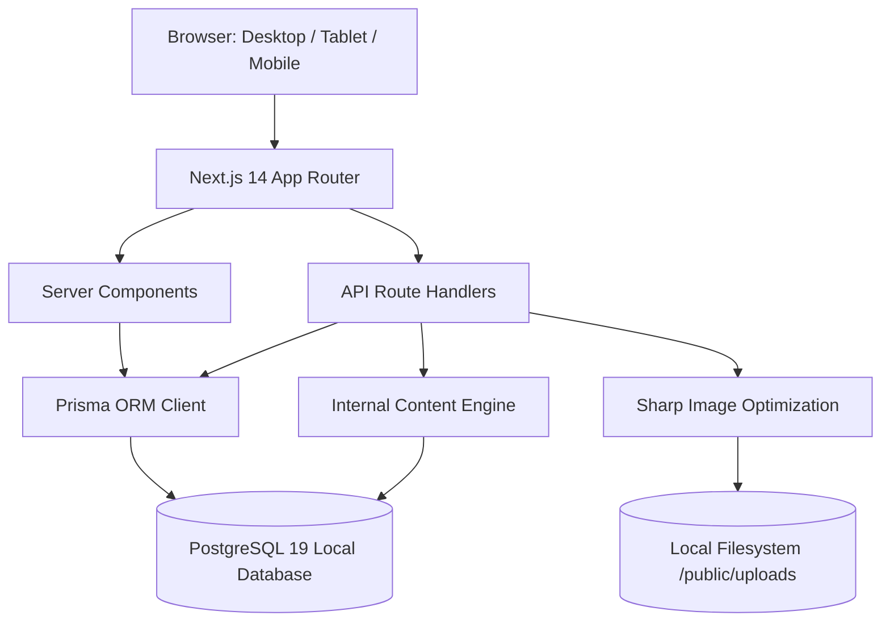

# System Architecture & Design System

## 1. Architectural Philosophy

Nesture Journal is designed around four foundational architectural principles:
1. **Self-Sovereignty**: Complete source code, database models, session stores, media management, and search engines remain entirely within the application boundary.
2. **Deterministic Processing**: Internal categorization, keyword mapping, tag recommendation, and reading-time calculations are executed by predictable, verifiable rule-based engines rather than unpredictable third-party AI APIs.
3. **Institutional Editorial Aesthetics**: High contrast typography, authoritative serif headlines, clean navy and emerald accents, and dense, scannable data layouts.
4. **Performance & Core Web Vitals**: Server Component pre-rendering, minimal client JavaScript footprints, optimized WebP imagery, and fast database indexed queries.

---

## 2. Technology Stack Breakdown

- **Frontend Framework**: Next.js 14 (App Router) with React 18 and TypeScript.
- **Styling**: Tailwind CSS with custom editorial brand tokens.
- **ORM & Data Layer**: Prisma ORM with connection pooling.
- **Database Engine**: Native PostgreSQL (Port 5432, UTF-8 C-locale cluster).
- **Icons**: Lucide React.
- **Testing**: Vitest for unit & integration, Playwright for multi-device E2E validation.

---

## 3. Editorial Color Palette

| Token | Hex Value | Semantic Usage |
|---|---|---|
| **Primary Navy** | `#071B2B` | Main header bar, footer backdrop, hero card background |
| **Secondary Navy** | `#102B3D` | Admin sidebar, dark card backgrounds, elevated surfaces |
| **Emerald Brand** | `#008F5A` | Primary CTA buttons, category badges, positive tickers, accents |
| **Deep Green** | `#006B45` | Breaking news pill, Market Intelligence header, active states |
| **Soft Background** | `#F5F7F6` | Category ribbon cards, news feed backgrounds, subtle pill tags |
| **Editorial Text Primary** | `#14202A` | Headline serif text, article body typography |
| **Editorial Text Secondary** | `#66717A` | Metadata dates, author titles, summary descriptions |
| **Border Divider** | `#E4E9E7` | Card borders, grid separators, table dividers |

---

## 4. Typography Hierarchy

- **Editorial Headings**: Classic Georgia serif with high legibility (`font-serif`, font-bold, tracking-tight).
- **Body & Data**: Clean sans-serif system font stack (`Inter`, `-apple-system`, `BlinkMacSystemFont`, `Segoe UI`, `Roboto`).
- **Financial & Market Tickers**: Monospace tabular digits (`font-mono`) for numerical alignment in stock prices, percentages, and reading-time metrics.
