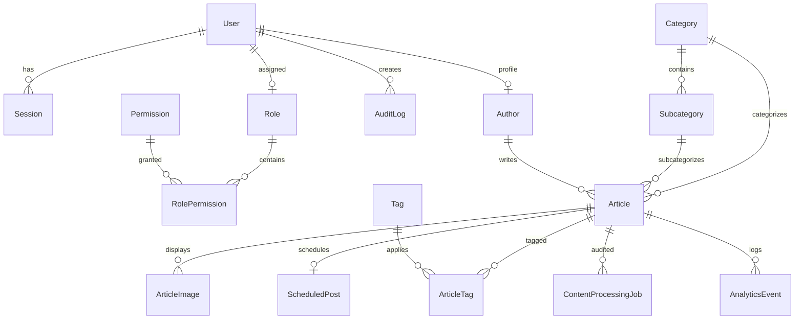

# PostgreSQL Database Architecture & Schema

Nesture Journal utilizes PostgreSQL as its primary relational store, managed via Prisma ORM (`prisma/schema.prisma`).

---

## 1. Entity-Relationship Overview

---

## 2. Core Database Models

### A. User, Role & Permissions
- `User`: Accounts for staff members (`id`, `email`, `passwordHash`, `name`, `roleId`, `isActive`).
- `Role`: Access tiers (`SUPER_ADMIN`, `ADMIN`, `EDITOR`, `AUTHOR`).
- `Permission`: Fine-grained scopes (`article:create`, `article:publish`, `category:manage`, `user:manage`, `settings:manage`).
- `Session`: Database-backed sessions linked to unique crypto tokens, IP addresses, and user-agent strings.

### B. Articles & Taxonomies
- `Article`: Core publication record.
  - Fields: `title`, `slug` (unique indexed), `shortDescription`, `content` (TEXT), `featuredImage`, `imageAlt`, `categoryId`, `subcategoryId`, `authorId`, `status` (`DRAFT`, `PENDING_APPROVAL`, `PUBLISHED`, `SCHEDULED`, `ARCHIVED`), `publicationDate`, `readingTime`, `viewCount`, `isFeatured`, `isTrending`, `isBreaking`, `seoTitle`, `seoDescription`, `canonicalUrl`.
- `Category`: Market verticals (`Residential`, `Commercial`, `International`, `Finance`, `Legal`, `Realty Tech`, `Development`, `General`) with custom color tokens and SEO descriptors.
- `Subcategory`: Nested sector niches (`Affordable Housing`, `Office Spaces`, `REITs`, `RERA Compliance`).
- `Tag` & `ArticleTag`: Many-to-many cross-category tagging.
- `ArticleImage`: Uploaded media assets with dimensions, MIME type, file size, and alt text.

### C. Market Intelligence & Analytics
- `MarketData`: Equity quotes, indices, and QoQ KPIs. Mandatory `isDemo: true` flag.
- `AnalyticsEvent`: Privacy-compliant event tracking (`PAGE_VIEW`, `ARTICLE_VIEW`, `SEARCH`).
- `SearchLog`: Monitored search terms with result count.
- `NewsletterSubscriber`: Opt-in reader records with double-checked consent tracking and unique tokens.
- `SiteSettings` & `SEOSettings`: Singleton site configurations.
- `AuditLog`: Immutable editorial action audit trail.

---

## 3. Database Indexes

Every critical query path has explicit PostgreSQL indexes:
- `Article`: `[slug]`, `[categoryId]`, `[status]`, `[isFeatured]`, `[isTrending]`, `[isBreaking]`, `[publicationDate]`.
- `Category`: `[slug]`.
- `Tag`: `[slug]`.
- `Session`: `[token]`, `[userId]`.
- `MarketData`: `[category]`.
- `AnalyticsEvent`: `[eventType]`, `[path]`, `[createdAt]`.
- `AuditLog`: `[action]`, `[entityType]`, `[createdAt]`.
